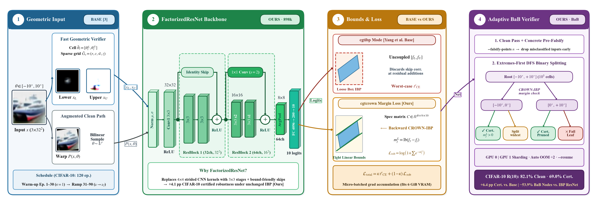
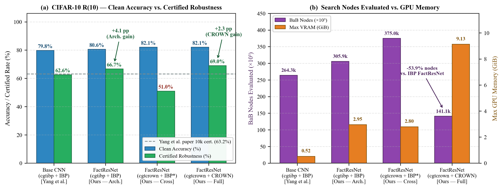

# Tightening Deterministic Geometric Robustness Certification via Residual Factorized Networks and Linear Relaxation Bound Propagation

> **Project Authors (Dept. of Information Technology):**  
> **Sankalp Brahmapurkar** (`IIT2023502`) · **Parth Agrawal** (`IIT2023506`) · **Kunal** (`IIT2023501`)

This repository extends **Certified Geometric Training (CGT)** and the **Fast Geometric Verifier (FGV)** introduced in the ICLR 2023 paper *"Provable Defense Against Geometric Transformations"* by Rem Yang, Jacob Laurel, Sasa Misailovic, and Gagandeep Singh ([`base_paper.pdf`](base_paper.pdf)).

While the Yang et al. baseline couples axis-aligned **Interval Bound Propagation (IBP)** with shallow sequential CNNs and static uniform grid verification, this project upgrades **architecture design**, **differentiable training optimization**, and **Branch-and-Bound (BaB) verification**, improving CIFAR-10 rotation $[-10^\circ, +10^\circ]$ performance on 1,000 test images from **79.8% clean / 62.6% certified** to **82.1% clean / 69.0% certified (+6.4 pp)** while cutting BaB node evaluations by **53.9%** relative to an IBP-trained residual model.

<p align="center">
  
</p>

---

## Key Extensions Over the Base Paper

| Component | Yang et al. Base Paper | This Project (Extensions) | Verified Impact |
| :--- | :--- | :--- | :--- |
| **Network Backbone** | 3-layer sequential CNN (`666,204` CIFAR-10 params; `662,786` MNIST params) | `FactorizedResNet` (`898,274` params: $3{\times}3$ blocks + identity/$1{\times}1$ skips + `AvgPool2d`) & MNIST Residual CNN (`664,834` params) | **+4.1 pp** CIFAR-10 certified robustness under unchanged `cgtibp` + `IBP` (`62.6% -> 66.7%`) |
| **Bound Propagation & Loss** | Axis-aligned IBP worst-case CE (`cgtibp`); no correlation across skip paths | Micro-batched differentiable `CROWN-IBP` log-sum-exp margin loss (`cgtcrown`) built on `auto_LiRPA` + control `IBP-C` verifier | Caps epoch-31/32 onset spike (`1.869` vs. `6.963`); **-46.5%** final CIFAR-10 loss (`0.3505` vs. `0.6558`) |
| **Certification Search (`certify.py`)** | Static uniform grid evaluation | Adaptive extremes-first DFS **Branch-and-Bound (BaB)** (`split_node`), `--falsify-points`, `--num-gpus` sharding, OOM batch halving, `--resume` | **-53.9%** BaB nodes vs. IBP-trained `FactorizedResNet` (`141,142` vs. `305,920`) |
| **CIFAR-10 $R(10)$ Net** | `79.8%` clean / `62.6%` cert. (1k repro.); `80.5% / 63.2%` (10k reported) | `FactorizedResNet` + `cgtcrown` + `CROWN-IBP` BaB (1k test images) | **82.1% clean / 69.0% cert.** (**+6.4 pp** vs. repro. base) |

---

## Empirical Results Summary

### CIFAR-10 Rotation $[-10^\circ, +10^\circ]$ Four-Way Ablation (`1,000` test images, `w=0.0002°`, `100k` cells, 2 GPUs, `--eval-batch-size 1024`)

| Architecture | Train Mode | Verifier | Clean Acc. | Certified Rob. | Δ vs. Repro. Base | BaB Nodes | Cert. Time | Max VRAM |
| :--- | :---: | :---: | :---: | :---: | :---: | ---: | ---: | ---: |
| Paper Baseline (10k reported) | `cgtibp` | `IBP` | 80.5% | 63.2% | N/A (10k imgs) | — | — | — |
| Base 3-Layer CNN (1k repro.) | `cgtibp` | `IBP` | 79.8% (798) | 62.6% (626) | Ref. | 264,320 | 955.4 s | 531.39 MB |
| `FactorizedResNet` (Arch. only) | `cgtibp` | `IBP` | 80.6% (806) | 66.7% (667) | **+4.1 pp** | 305,920 | 1835.8 s | 3024.31 MB |
| `FactorizedResNet` (Cross-mismatch) | `cgtcrown` | `IBP` | **82.1%** (821) | 51.0% (510) | -11.6 pp | 375,000 | 5169.4 s | 2868.99 MB |
| **`FactorizedResNet` (Full, Ours)** | `cgtcrown` | `CROWN-IBP` | **82.1%** (821) | **69.0%** (690) | **+6.4 pp** | **141,142** | 9270.8 s | 9350.99 MB |

<p align="center">
  
</p>

### MNIST Rotation $[-30^\circ, +30^\circ]$ Highlights (`w=0.25°`, `240` cells)
- **Full 10,000-image baseline reproduction (`IBP`):** `99.14%` clean accuracy, `94.21%` certified robustness in `66.32 s`.
- **100-image Verifier & Margin Ablation (`--batch-size 32`):**
  - Yang et al. Baseline (`IBP Loss`): `IBP` -> `94.0%` (`10.68 s`), control `IBP-C` -> `94.0%` (`4.87 s`), `CROWN-IBP` -> `96.0%` (`33.97 s`, `79.05 MB`).
  - Sequential CNN (`CROWN-IBP` Margin): `IBP` -> `90.0%` (`8.11 s`), `IBP-C` -> `91.0%` (`8.29 s`), matched `CROWN-IBP` -> **`96.0%` in `24.67 s`** (**27.4% faster** than evaluating the IBP-trained baseline with `CROWN-IBP`).
- **FGV Pixel Interval Width Tightening:** Recursive sub-interval splitting reduces mean `(x_U - x_L)` width from **`0.955 -> 0.183`** on CIFAR-10 and **`0.644 -> 0.008`** on MNIST.

---

## Repository Structure

```text
.
├── train.py                    # Differentiable CROWN-IBP (cgtcrown) & IBP (cgtibp) training with micro-batching & TensorBoard
├── certify.py                  # Adaptive extremes-first DFS BaB certifier with multi-GPU sharding, OOM halving, & pre-falsification
├── certify_driving.py          # Deterministic certification for Udacity steering-angle regression models
├── compute_img_widths.py       # Empirical FGV pixel interval width analyzer
├── preprocess_driving.py       # Preprocesses Udacity rosbag exports into driving_train.pt / driving_test.pt
├── definitions.py              # Transform, dataset, and training mode constants (ROTATE, CGT_IBP, CGT_CROWN, etc.)
├── configs/
│   ├── layers.py               # Input normalization layer (NormalizeInput)
│   ├── mnist_config.py         # MNIST datasets, Config 0..3 transforms, and Residual CNN (use_residual=True/False)
│   ├── cifar10_config.py       # CIFAR-10 datasets, Config 0..2 transforms, and FactorizedResNet (use_residual=True/False)
│   ├── cifar_config.py         # Forwarding alias for configs.cifar10_config
│   ├── tinyimagenet_config.py  # Tiny ImageNet dataset & CNN7 / WideResNet configs
│   ├── driving_config.py       # Udacity self-driving dataset & model configs
│   └── wide_resnet_imagenet64.py
├── geometric/                  # FGV interval arithmetic, bilinear sparse grids, & scalar geometric warps
├── networks/                   # Pretrained baseline checkpoints (MNIST, CIFAR-10, Tiny ImageNet, Driving)
├── saved_models/               # Trained checkpoints from extended experiments (saved_models/mnist/, saved_models/cifar/)
├── runs/                       # TensorBoard event traces
├── epoch_curve/                # Verified epoch vs. loss logs (base_paper.txt, updated_ibp.txt)
├── report/                     # IEEE 6-page conference report (main.tex) and publication figures (*.png)
└── cgt_run_results_and_docs/   # CSV experiment logs and supplemental analysis scripts/figures
```

---

## Requirements & Setup

Tested locally on Windows 10/11 and multi-GPU Kaggle Linux with `torch==1.12.1+cu113` (upstream `README` also targets `torch==1.11.0+cu113`).

```bash
# 1. Install PyTorch with CUDA support
pip install torch==1.12.1+cu113 torchvision==0.13.1+cu113 --extra-index-url https://download.pytorch.org/whl/cu113

# 2. Install remaining dependencies
pip install -r requirements.txt
```

Core dependencies in `requirements.txt`: `auto_LiRPA`, `numpy`, `pandas`, `scipy`, `torchattacks`, `tqdm`.  
All core scripts use Windows-safe process handling (`--num-workers` defaults to `0` on Windows and `2`/`4` on Linux) and `os.makedirs(..., exist_ok=True)`.

---

## Datasets

- **MNIST & CIFAR-10:** Automatically downloaded into `datasets/` when running `train.py` or `certify.py`.
- **Tiny ImageNet:** Download manually using the [auto_LiRPA script](https://github.com/Verified-Intelligence/auto_LiRPA/blob/master/examples/vision/data/tinyImageNet/tinyimagenet_download.sh).
- **Udacity Self-Driving:** Download train/test rosbags ([CH2](https://github.com/udacity/self-driving-car/tree/master/datasets/CH2)) and test labels ([CH2_final_evaluation.csv](https://github.com/udacity/self-driving-car/blob/master/challenges/challenge-2/CH2_final_evaluation.csv)), decode via [udacity-driving-reader](https://github.com/rwightman/udacity-driving-reader) into `udacity-driving-dataset/`, and run `python preprocess_driving.py`.

---

## Usage

### 1. Training (`train.py`)

`train.py` defaults to `-t cgtcrown` (`CROWN-IBP` log-sum-exp margin training) and automatically instantiates the residual network when `configs/<dataset>_config.py` defines `use_residual=True`:

```bash
# CIFAR-10 FactorizedResNet with CROWN-IBP margin training (Config 0: Rotate [-10, +10], w=0.001)
python train.py -d cifar10 -t cgtcrown -c 0 -b 128 --robust-batch-size 32 --epochs 120 --lr 0.001 --tensorboard --save-dir saved_models

# CIFAR-10 FactorizedResNet with IBP training (Architecture ablation)
python train.py -d cifar10 -t cgtibp -c 0 -b 128 --epochs 120 --lr 0.001 --tensorboard --save-dir saved_models

# MNIST Residual CNN with CROWN-IBP margin training (Config 0: Rotate [-30, +30], w=0.5)
python train.py -d mnist -t cgtcrown -c 0 -b 256 --robust-batch-size 128 --epochs 100 --lr 0.001 --tensorboard --save-dir saved_models
```

**Additional `train.py` flags:**
- `-t, --train-mode`: `cgtcrown` (default), `cgtibp`, `augmented`, `pgda`, `ibpa` (plus alias `cgt_crown`).
- `--bound-method`: Override bound method (`IBP` or `CROWN-IBP`).
- `--robust-batch-size`: Sub-batch size (default `128`) for gradient-accumulated `CROWN-IBP` backward graphs within `6 GiB` VRAM.
- `--start-interval-epoch`, `--ramp-up-epochs`, `--milestones`: Customize warm-up, perturbation ramp length, and `MultiStepLR` milestones (defaults: warm-up ep `16` MNIST / `31` CIFAR-10 & Tiny / `1` Driving; LR drop ep `80` MNIST / `100` CIFAR-10).
- `--resume <ckpt.pt>` & `--start-epoch <N>`: Resume weights, optimizer, LR scheduler, and `kappa`/`eps` schedules (auto-infers epoch from `*_ep<N>.pt` filenames).
- `--save-dir`, `--save-path`, `--save-every`, `--validate-every`, `--tensorboard`, `--tb-dir`, `--multi-gpu`.

---

### 2. Adaptive Branch-and-Bound Certification (`certify.py`)

`certify.py` automatically detects whether a checkpoint uses residual connections (`downsample.weight`, `res1_conv1.weight`, `res2_shortcut.weight`, or `resnet` in filename) and loads both baseline Yang et al. models and our residual checkpoints transparently:

```bash
# CIFAR-10 Rotation [-10, +10] across 1,000 test images using CROWN-IBP on 2 GPUs with pre-falsification
python certify.py -d cifar10 -c 0 -p saved_models/cifar/cgt_crown_factorized_resnet_rotate-10.pt \
    --method CROWN-IBP --max-images 1000 --num-gpus 2 --eval-batch-size 1024 --falsify-points 9

# MNIST Rotation [-30, +30] baseline reproduction across all 10,000 test images
python certify.py -d mnist -c 0 -p networks/mnist/cgt_rotate-30^30^0.5.pt --method IBP -b 1024 --eval-batch-size 1024

# Resume an interrupted multi-GPU run from checkpoints
python certify.py -d cifar10 -c 0 -p saved_models/cifar/cgt_crown_factorized_resnet_rotate-10.pt \
    --method CROWN-IBP --max-images 1000 --num-gpus 2 --eval-batch-size 1024 --ckpt-dir ckpt --resume
```

**Additional `certify.py` flags:**
- `--method`: `CROWN-IBP` (default), `CROWN`, `IBP-C` (control specification-matrix IBP), or `IBP`.
- `--eval-batch-size`: Max images per BaB propagation batch (default `128`; automatically halves on CUDA OOM).
- `--falsify-points <n>`: Evaluates `n` concrete transformation parameters per image before BaB to soundly drop misclassified samples upfront.
- `--init-cells`, `--min-cells`, `--max-node-evals`, `--time-limit`: Control initial cell grouping, minimum leaf granularity, per-image BaB evaluation cap, and per-GPU wall-clock limit.
- `--num-gpus`, `--ckpt-dir`, `--ckpt-interval`, `--resume`: Multi-GPU interleaved worker launcher and periodic state checkpointing.
- `--max-images`, `--val`, `--save` (`certified_indices/<dataset>/`), `--profile`.

---

### 3. Self-Driving & Interval Width Utilities

```bash
# Self-driving steering certification (Udacity)
python certify_driving.py -c <config_num> -p <network_path> -b <batch_size> [--dropout]

# Empirical FGV per-pixel interval widths across test/train splits
python compute_img_widths.py -d cifar10 -t test -c 0 -s 10 -f 1.0
```

---

## Technical Report

The complete 6-page IEEE conference paper source and publication figures live in [`report/`](report):
- [`report/main.tex`](report/main.tex)
- [`report/methodology_diagram.png`](report/methodology_diagram.png)
- [`report/fgv_interval_bounds.png`](report/fgv_interval_bounds.png)
- [`report/training_loss_curves.png`](report/training_loss_curves.png)
- [`report/cifar10_ablation_comparison.png`](report/cifar10_ablation_comparison.png)
